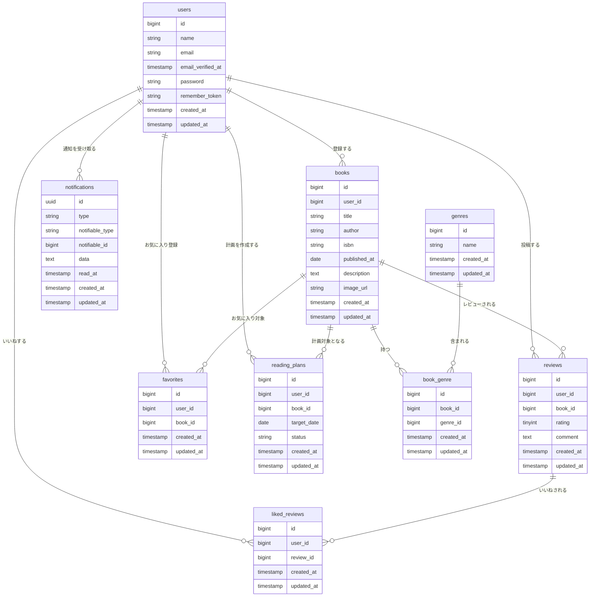

# BookShelf 書籍レビューアプリ

書籍レビューをアプリを実装したLaravelプロジェクトです。
一般ユーザは書籍一覧等一部のみ閲覧可能。
会員登録、ログイン後、書籍の登録、レビュー、いいね機能に加え
ランキング、マイレポート、読書計画機能も使用することができる。

## 作成者

竹内　麻耶

## 使用技術

- PHP 8.5
- Laravel 10.x
- MySQL 8.4
- Nginx
- Docker / Docker Compose / Laravel Sail
- Vite / Tailwind CSS 3.4
- Laravel Fortify（認証）
- phpMyAdmin

## ER図




## 開発環境URL

http://localhost

## 動作環境

- Docker
- Docker Compose


## 環境構築手順

1. **Laravel 10.xプロジェクトを作成**

    ```bash
    docker run --rm -u "$(id -u):$(id -g)" -v "$(pwd):/var/www/html" -w /var/www/html -e COMPOSER_CACHE_DIR=/tmp/composer_cache laravelsail/php82-composer:latest composer create-project laravel/laravel:^10.0 bookshelf-app
    ```

2. **.envファイルの準備**

    `.env.example` をコピーして `.env` を作成します。

    ```bash
    cp .env.example .env
    ```

    `.env` ファイル内の以下のDB接続情報を確認・設定します。`.env.example` のデフォルト値はSail向けではないため、以下のように変更してください。

    ```ini
    DB_CONNECTION=mysql
    DB_HOST=mysql
    DB_PORT=3306
    DB_DATABASE=laravel
    DB_USERNAME=sail
    DB_PASSWORD=password

    重要: DB_HOST は localhost や 127.0.0.1 ではなく、Dockerコンテナ名である mysql を指定します。
    ```

3. **Laravel Sailをインストール**

    ```bash
    docker run --rm \
    -u "$(id -u):$(id -g)" \
    -v "$(pwd):/var/www/html" \
    -w /var/www/html \
    -e COMPOSER_CACHE_DIR=/tmp/composer_cache \
    laravelsail/php82-composer:latest \
    composer require laravel/sail --dev
    ```

4. **設定ファイルの生成**

    ```bash
    docker run --rm \
    -u "$(id -u):$(id -g)" \
    -v "$(pwd):/var/www/html" \
    -w /var/www/html \
    -e COMPOSER_CACHE_DIR=/tmp/composer_cache \
    laravelsail/php82-composer:latest \
    php artisan sail:install --with=mysql
    ```

5. **Laravel Sailの起動**

    以下のコマンドでDockerコンテナを起動します。

    ```bash
    ./vendor/bin/sail up -d
    ```

    > **エイリアスの設定（推奨）**
    >
    > 毎回 `./vendor/bin/sail` と入力するのは手間なので、エイリアスを設定すると便利です。
    >
    > ```bash
    > alias sail='[ -f sail ] && bash sail || bash vendor/bin/sail'
    > ```

6. **アプリケーションキーの生成**

    ```bash
    sail artisan key:generate
    ```

7. **データベースのマイグレーションと初期データ投入**

    以下のコマンドでテーブルを作成し、ダミーデータを投入します。

    ```bash
    sail artisan migrate:fresh --seed
    ```
    このコマンドの入力後、下記のエラーが表示されることがあります。
    ```bash
       Illuminate\Database\QueryException 
      SQLSTATE[HY000] [1044] Access denied for user 'sail'@'%' to database 'contact-form-app' (Connection: mysql, SQL: select table_name as `name`,         (data_length + index_length) as `size`, table_comment as `comment`, engine as `engine`, table_collation as `collation` from information_schema.tables where table_schema = 'contact-form-app' and table_type in ('BASE TABLE', 'SYSTEM VERSIONED') order by table_name)

      at vendor/laravel/framework/src/Illuminate/Database/Connection.php:829
        825▕                     $this->getName(), $query, $this->prepareBindings($bindings), $e
        826▕                 );
        827▕             }
        828▕ 
      ➜ 829▕             throw new QueryException(
        830▕                 $this->getName(), $query, $this->prepareBindings($bindings), $e
        831▕             );
        832▕         }
        833▕     }

      +43 vendor frames 

      44  artisan:35
          Illuminate\Foundation\Console\Kernel::handle()
    ```
    このエラーはコンテナ内にデータが残っており、エラーが生じているケースなどがあります。
    その場合は、以下のコマンドを順に実行して各コンテナを再起動して下さい。
    ```Bash
    sail down -v
    sail up -d　//コマンド実行後にSQLコンテナが立ち上がるまで時間がかかります。30秒ほどお待ちください。
    sail artisan migrate:fresh --seed
    ```
    
8. **フロントエンドのビルド**

    ```bash
    sail npm install
    sail npm install alpinejs
    sail npm install -D tailwindcss@^3.4.0 @tailwindcss/forms postcss autoprefixer
    sail npx tailwindcss init -p
    tailwind.config.js を以下の内容で上書きしてください：
    import defaultTheme from 'tailwindcss/defaultTheme';
    import forms from '@tailwindcss/forms';

    /** @type {import('tailwindcss').Config} */
    export default {
    content: [
        './vendor/laravel/framework/src/Illuminate/Pagination/resources/views/*.blade.php',
        './storage/framework/views/*.php',
        './resources/views/**/*.blade.php',
    ],
    theme: {
        extend: {
            fontFamily: {
                sans: ['Figtree', ...defaultTheme.fontFamily.sans],
            },
        },
    },
    plugins: [forms],
    };

    sail npm run dev
    ```

    `npm run dev` は開発中は起動したままにしてください。

9. **phpMyAdminの追加**

    compose.yaml を開き、mysql サービスの後に以下の設定を追加してください。

    phpmyadmin:
        image: 'phpmyadmin:latest'
        ports:
            - '${FORWARD_PHPMYADMIN_PORT:-8080}:80'
        environment:
            PMA_HOST: mysql
            PMA_USER: '${DB_USERNAME}'
            PMA_PASSWORD: '${DB_PASSWORD}'
        networks:
            - sail
        depends_on:
            - mysql

10. **アプリケーションへのアクセス**

    ブラウザで [http://localhost](http://localhost) にアクセスします。

## テスト実行

```bash
sail artisan test
```

カバレッジ付きで実行する場合:

```bash
sail artisan test --coverage
```

## 機能一覧

- ユーザ認証（登録・ログイン・ログアウト）
- 書籍（一覧・詳細・登録・編集・削除）検索
- レビュー（一覧・詳細・登録・編集・削除）
- ジャンル（一覧・詳細・登録・編集・削除）
- お気に入り一覧
- ランキング一覧
- マイ読書レポート
- 読書計画
- 通知機能
- 公開API

## APIエンドポイント一覧

認証不要の公開APIです。全エンドポイントは `/api/v1` プレフィックス配下に定義されています。

| HTTPメソッド | URI | 概要 |
|---|---|---|
| GET |	/api/v1/books | 書籍一覧を取得する
| GET |	/api/v1/books/{book} | 書籍詳細を取得する
| POST | /api/v1/books | 書籍を新規登録する
| PUT | /api/v1/books/{book} | 書籍を更新する
| DELETE | /api/v1/books/{book} | 書籍を削除する